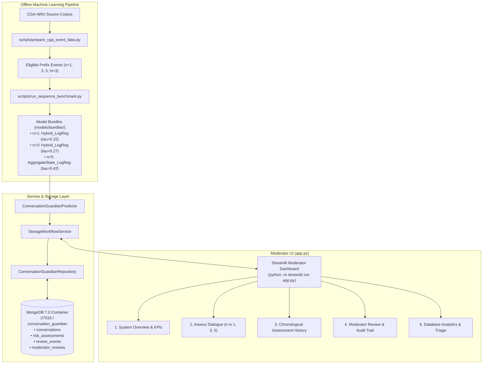

# ConversationGuardian — Gate 1

ConversationGuardian is an academic research and engineering platform for early warning and moderation of conversational derailment in online discussion platforms.

This repository implements **Gate 1: Fresh Data Pipeline & Forecast-Target Validation**, establishing a clean-room, leakage-free data construction process using the Cornell ConvoKit CGA-WIKI corpus (*conversations-gone-awry-corpus*; Zhang et al., ACL 2018).

---

## 1. Project Purpose & Precise Target Definition

The objective of Gate 1 is to define and validate an online conversational event-forecasting target without data leakage or post-attack lookahead.

### Forecasting Task
- **Primary Target:** Predict whether an annotated personal attack occurs within the next three messages ($H = 3$) following an observed prefix of length $n_{\text{observed}}$.
- **Observation Checkpoints:** Fixed conversational prefixes $n_{\text{observed}} \in \{1, 3, 5\}$.
- **Observed Window:** Dialogue turns $0 \dots n_{\text{observed}} - 1$.
- **Forecast Window:** Dialogue turns $n_{\text{observed}} \dots n_{\text{observed}} + 2$.

### Boundary Decision Rules
- **Insufficient Observed Prefix ($L < n_{\text{observed}}$):** Excluded (`INSUFFICIENT_OBSERVED_PREFIX`), target label is `None`.
- **Attack Already Observed ($p_{\text{att}} < n_{\text{observed}}$):** Excluded (`ATTACK_ALREADY_OBSERVED`), target label is `None`. Once derailment has already occurred, predicting future derailment is no longer an early warning.
- **Positive Event ($p_{\text{att}} \in [n_{\text{observed}}, n_{\text{observed}} + 2]$):** Eligible (`POSITIVE_EVENT`), target label is `1`. This holds even if the dialogue subsequently terminates before the full 3 turns elapse.
- **Negative Event (No attack in window and $L \ge n_{\text{observed}} + 3$):** Eligible (`NEGATIVE_EVENT`), target label is `0`.
- **Right-Censored Window (No attack in window and $L < n_{\text{observed}} + 3$):** Excluded (`CENSORED_INCOMPLETE_WINDOW`), target label is `None`. Peaceful dialogue that ends before 3 future turns can be observed is right-censored and excluded from binary classification.

---

## 2. Environment & Prerequisites

- **Supported Python Runtime:** Python 3.10 to 3.13 (Tested on Python 3.13.3 64-bit).
- **Core Dependencies:**
  - `convokit==4.1.2`
  - `pandas==3.0.3`
  - `numpy==2.4.6`
  - `pyarrow==24.0.0`
  - `scikit-learn==1.9.0`

### Setup Instructions

```bash
# 1. Create a virtual environment
python -m venv .venv

# 2. Activate the virtual environment
# On Windows PowerShell:
.venv\Scripts\Activate.ps1
# On Linux / macOS:
source .venv/bin/activate

# 3. Install pinned dependencies
pip install -r requirements.txt
```

---

## 3. Data Acquisition & Corpus Access

The pipeline uses the official Cornell ConvoKit `conversations-gone-awry-corpus` (4,188 Wikipedia talk page conversations; 30,021 utterances; 2,094 mutual pairs).

The source loader automatically downloads the official corpus using `convokit.download('conversations-gone-awry-corpus')` if not already present in the standard ConvoKit cache directory (`~/.convokit/saved-corpora/conversations-gone-awry-corpus`).

Alternatively, an existing local corpus directory can be explicitly specified:
```bash
python scripts/prepare_cga_event_data.py --source-dir /path/to/conversations-gone-awry-corpus
```
If `--source-dir` is provided but invalid or missing required files (`conversations.json`, `utterances.jsonl`), the loader fails fast with a clear error rather than falling back silently.

---

## 4. Running the Pipeline

Execute the standalone CLI data preparation script:

```bash
python scripts/prepare_cga_event_data.py
```

Optional CLI flags:
- `--source-dir <path>`: Path to local raw ConvoKit corpus (defaults to ConvoKit cache/download).
- `--output-dir <path>`: Destination directory for partitioned event Parquet files (default: `data/events`).
- `--reports-dir <path>`: Destination directory for audit reports (default: `reports/gate1`).
- `--horizon <int>`: Forecasting horizon $H$ (default: `3`).
- `--checkpoints <int ...>`: Observation checkpoints (default: `1 3 5`).

The script enforces strict validation checks:
- Pair reciprocity and zero cross-partition leakage across official `train`, `val`, and `test` splits.
- 100% agreement between conversation-level attack flags and turn-level attack annotations.
- Full execution of the regression test suite, exiting with a non-zero exit code if any test fails.

---

## 5. Running Tests

Execute the unit and regression test suite:

```bash
python -m unittest discover -s tests -v
```

All 12+ critical boundary conditions and integrity checks are covered.

---

## 6. Project Artifacts & Commit Policy

### Tracked in Git
- `src/conversation_guardian/`: Core data structures, source loader, event builder, and ML baseline routines.
- `scripts/prepare_cga_event_data.py`: Deterministic CLI dataset builder.
- `scripts/run_baseline_benchmark.py`: Word+Char TF-IDF Logistic Regression & Prior baseline benchmark CLI.
- `tests/`: Comprehensive unit and regression test suites.
- `reports/gate1/`: Audit artifacts and data dictionary.
- `reports/benchmarks/`: Benchmark evaluation metrics and test prediction records.

### Intentionally Not Committed (`.gitignore`)
- `data/` and `data/events/*.parquet`: Generated event dataset files are kept out of Git.
- `models/`: Trained model binaries (`*.joblib`, `*.pt`, `*.bin`).
- Raw corpus caches and virtual environments (`.venv/`, `__pycache__/`).
- Model checkpoints and credentials.

---

## 7. Running the Machine Learning Benchmark

Train and evaluate the checkpoint-specific word-and-character TF-IDF Logistic Regression baseline against the empirical prior baseline:

```bash
python scripts/run_baseline_benchmark.py
```

This fits models strictly on eligible training examples, selects optimal F1 classification thresholds on validation predictions, freezes the thresholds, and reports final test metrics (AP, ROC-AUC, Precision, Recall, F1, Accuracy, Brier score, Confusion matrix).

---

## 8. Sequential & Recurrent Modeling Benchmarks (Tasks 3, 4, 5)

### Running the Sequence State Benchmark (Task 3)
```bash
python scripts/run_sequence_benchmark.py
```
Fits and benchmarks the text baseline alongside orderless Aggregate-State, Ordered-State (transitions, trigrams, position states, trajectories), and Hybrid (TF-IDF + Ordered State) models. Automatically exports deployable predictor bundles under `models/selected_predictors/`.

### Running the Deployable Prediction Service Smoke Test (Task 4)
```bash
python scripts/smoke_test_predictor.py
```
Executes inference via `ConversationGuardianPredictor` across checkpoints $n=1, 3, 5$, producing JSON risk scores, validation thresholds, alert flags, and compact heuristic tone summaries.

### Running the Recurrent Sequence Model Benchmark (Task 5)
```bash
python scripts/run_recurrent_benchmark.py
```
Trains a word-level `ConversationGRU` sequence model directly on ordered dialogue turns with early stopping on validation Average Precision (AP).

### Model Comparison Summary (Test Set, $H = 3$)

| $n$ | Model | Test Prev | Frozen Thresh | AP | ROC-AUC | Accuracy | Precision | Recall | $F_1$ | Brier Score |
|---|---|---|---|---|---|---|---|---|---|---|
| **1** | **MajorityBaseline** | 0.0963 | 0.50 | 0.0963 | 0.5000 | 0.9037 | 0.0000 | 0.0000 | 0.0000 | 0.0963 |
| 1 | **PriorBaseline** | 0.0963 | 0.50 | 0.0963 | 0.5000 | 0.9037 | 0.0000 | 0.0000 | 0.0000 | 0.0871 |
| 1 | **TFIDF_TextBaseline** | 0.0963 | 0.20 | 0.3250 | 0.8033 | 0.8870 | 0.3556 | 0.2133 | 0.2667 | 0.0782 |
| 1 | **AggregateState_LogReg** | 0.0963 | 0.21 | 0.2722 | 0.7821 | 0.8768 | 0.2941 | 0.2000 | 0.2381 | 0.0794 |
| 1 | **OrderedState_LogReg** | 0.0963 | 0.21 | 0.2720 | 0.7820 | 0.8768 | 0.2941 | 0.2000 | 0.2381 | 0.0794 |
| 1 | **Hybrid_LogReg** (Deployable) | 0.0963 | 0.15 | **0.3425** | **0.8090** | 0.8703 | **0.3673** | **0.4800** | **0.4162** | **0.0759** |
| 1 | **Recurrent_GRU** | 0.0963 | 0.23 | 0.2655 | 0.7371 | 0.8922 | 0.3548 | 0.1467 | 0.2075 | 0.0844 |
|---|---|---|---|---|---|---|---|---|---|---|
| **3** | **MajorityBaseline** | 0.3506 | 0.50 | 0.3506 | 0.5000 | 0.6494 | 0.0000 | 0.0000 | 0.0000 | 0.3506 |
| 3 | **PriorBaseline** | 0.3506 | 0.50 | 0.3506 | 0.5000 | 0.6494 | 0.0000 | 0.0000 | 0.0000 | 0.2282 |
| 3 | **TFIDF_TextBaseline** | 0.3506 | 0.29 | **0.5601** | **0.6735** | **0.6104** | **0.4605** | 0.6481 | **0.5385** | **0.2051** |
| 3 | **AggregateState_LogReg** | 0.3506 | 0.28 | 0.4661 | 0.6162 | 0.4805 | 0.3807 | 0.7685 | 0.5092 | 0.2201 |
| 3 | **OrderedState_LogReg** | 0.3506 | 0.25 | 0.4397 | 0.6059 | 0.4886 | 0.3883 | 0.7963 | 0.5220 | 0.2251 |
| 3 | **Hybrid_LogReg** (Deployable) | 0.3506 | 0.27 | 0.5297 | 0.6548 | 0.5795 | 0.4362 | 0.6806 | 0.5316 | 0.2120 |
| 3 | **Recurrent_GRU** | 0.3506 | 0.03 | 0.4482 | 0.6061 | 0.3506 | 0.3506 | 1.0000 | 0.5192 | 0.2460 |
|---|---|---|---|---|---|---|---|---|---|---|
| **5** | **MajorityBaseline** | 0.4957 | 0.50 | 0.4957 | 0.5000 | 0.4957 | 0.4957 | 1.0000 | 0.6628 | 0.5043 |
| 5 | **PriorBaseline** | 0.4957 | 0.50 | 0.4957 | 0.5000 | 0.4957 | 0.4957 | 1.0000 | 0.6628 | 0.2502 |
| 5 | **TFIDF_TextBaseline** | 0.4957 | 0.36 | 0.5763 | 0.5414 | 0.5043 | 0.5000 | 0.9827 | 0.6628 | 0.2504 |
| 5 | **AggregateState_LogReg** (Deployable) | 0.4957 | 0.42 | **0.5841** | **0.5639** | **0.5158** | **0.5065** | 0.9075 | 0.6501 | **0.2470** |
| 5 | **OrderedState_LogReg** | 0.4957 | 0.04 | 0.5686 | 0.5580 | 0.4928 | 0.4942 | 0.9884 | 0.6590 | 0.2597 |
| 5 | **Hybrid_LogReg** | 0.4957 | 0.26 | 0.5707 | 0.5563 | 0.5014 | 0.4985 | 0.9422 | 0.6520 | 0.2637 |
| 5 | **Recurrent_GRU** | 0.4957 | 0.17 | 0.5501 | 0.5377 | 0.4986 | 0.4971 | 0.9942 | 0.6628 | 0.2715 |

### Empirical Findings & Limitations
1. **Recurrent Modeling vs Tabular Baselines**: Training a word-level GRU directly on dialogue tokens did not outperform the feature-engineered baselines on validation AP (Val AP at $n=1$: 0.2583 vs Hybrid's 0.3409; at $n=3$: 0.3623 vs Hybrid's 0.4987; at $n=5$: 0.5849 vs AggregateState's 0.6284).
2. **Model Selection Gate**: Following our validation-first selection criterion, the incumbent models (`Hybrid_LogReg` for $n=1, 3$ and `AggregateState_LogReg` for $n=5$) retain their deployable status.
3. **Computational Tradeoff**: The GRU requires 347,009 trainable parameters and significantly more training time on CPU than regularized logistic regression, without yielding superior ranking discrimination on short conversational contexts.

---

## 9. MongoDB Persistence & Moderator Audit Workflow (Task 6)

### Architecture Overview

ConversationGuardian includes a persistence and audit layer built on MongoDB and PyMongo, enabling persistent storage of multi-checkpoint risk assessments, moderator decisions, and immutable audit event trails.

The persistence architecture consists of four distinct collections:

| Collection | Role & Purpose | Mutability | Primary & Secondary Indexes |
|---|---|---|---|
| `conversations` | Thread metadata, channel origin, current overall status, and pointer to latest assessment. | Mutable (upsert) | `conversation_id` (Unique)<br>`review_status` |
| `risk_assessments` | Immutable record of inference results ($n \in \{1, 3, 5\}$, $H=3$, uncalibrated risk score, threshold, alert flag, model metadata, heuristic signal summary). | Append-only (Historical) | `assessment_id` (Unique)<br>`(conversation_id, created_at)` (Compound)<br>`(checkpoint_n_obs, alert)`<br>`(alert, created_at)` |
| `moderator_reviews` | Current active review state and decision for an assessment. | Mutable (upsert) | `assessment_id` (Unique)<br>`conversation_id`<br>`review_status` |
| `review_events` | Comprehensive audit trail recording every moderator action (creation, status change, decision change). | Append-only (Strictly immutable) | `event_id` (Unique)<br>`(conversation_id, event_time)` (Compound)<br>`(assessment_id, event_time)` |

### Why Review History Is Separate From Current Review Record

Moderation platforms operate in an adversarial and regulatory environment where decisions may be revised upon appeal, escalation, or peer review. 
1. **Current State Query Efficiency**: Real-time moderation queues and dashboard panels query `moderator_reviews` directly by `review_status` (e.g., finding all `IN_REVIEW` or `PENDING` tickets) without scanning historical logs.
2. **Tamper-Evident Auditability**: `review_events` is strictly append-only. The application exposes no update or delete primitives for review events. When a moderator adjusts a decision (e.g., from `NO_ACTION` to `WARN_USER`), the event log retains both the previous and new states, timestamp, and actor ID.
3. **Atomicity and Failure Recovery**: On standalone MongoDB nodes (without a replica set), multi-document ACID transactions are not available. State transitions sequentially update `moderator_reviews` and append to `review_events`. In high-availability environments running a replica set, operations can execute within transactional sessions (`client.start_session()`).

### Configuration & Docker Compose Setup

#### Prerequisites
- **Docker & Docker Compose**: Docker 20.10+ and Docker Compose v2+ (e.g., Docker Desktop on Windows with WSL2 backend). Ensure Docker Desktop is launched and running.
- **Python Driver**: `pymongo>=4.0.0` (pinned to `4.17.0` in `requirements.txt`).

#### Configuration Variables

Configuration is resolved via standard environment variables:

| Variable | Default Value | Description |
|---|---|---|
| `MONGODB_HOST_PORT` | `27018` | Published host port for Docker Compose (configured to `27018` to avoid collision with standard host-level `27017` MongoDB services). |
| `MONGODB_URI` | `mongodb://127.0.0.1:27018` | MongoDB connection URI. Defaults to `mongodb://127.0.0.1:{MONGODB_HOST_PORT}` if unset. (Never commit actual credentials to Git). |
| `MONGODB_DATABASE` | `conversation_guardian` | Target MongoDB database name. |

A safe template is provided in [`.env.example`](file:///D:/DS%20Projects/ConversationGuardian_Gate1/.env.example).

#### Running MongoDB Locally via Docker Compose

```bash
# 1. Start MongoDB in detached mode
docker compose up -d

# 2. Check container health status (verifies mongo:7.0 is healthy and mapped to 127.0.0.1:27018)
docker compose ps

# 3. View service logs
docker compose logs -f mongodb

# 4. Stop MongoDB and preserve named volume
docker compose down
```

The [`docker-compose.yml`](file:///D:/DS%20Projects/ConversationGuardian_Gate1/docker-compose.yml) binds strictly to `127.0.0.1:${MONGODB_HOST_PORT:-27018}:27017` to prevent accidental public network exposure and utilizes a named persistent volume (`conversation_guardian_mongodb_data`).

#### Troubleshooting Port Conflicts Without Stopping Unrelated Services

If port 27017 or 27018 is already bound by a pre-existing host service (e.g., a local Windows MongoDB service or another container):
1. **Identify the listener:**
   - PowerShell: `Get-NetTCPConnection -LocalPort 27017 -ErrorAction SilentlyContinue | Format-Table`
   - Command Prompt: `netstat -ano | findstr :27017`
2. **Do NOT kill or terminate unrelated host services.** Instead, simply configure an alternative free host port for this project:
   - In `.env` (or shell): set `MONGODB_HOST_PORT=27019`
   - Re-run `docker compose up -d`
   - Python code and scripts automatically derive `mongodb://127.0.0.1:27019` without any manual code changes.

### Running the Demonstration Script

A standalone demonstration script exercises the full persistence lifecycle:

```bash
python scripts/demo_mongodb_workflow.py
```

The script executes 8 automated workflow steps:
1. Connects to MongoDB (`mongodb://127.0.0.1:27018`) with connection ping verification.
2. Applies collection `$jsonSchema` validators and creates indexes.
3. Initializes the deployable predictor and storage workflow service.
4. Creates or retrieves a demonstration conversation record.
5. Evaluates dialogue prefixes at checkpoints $n=1, 3, 5$ and stores risk assessments.
6. Reads back the chronological assessment history.
7. Simulates moderator review transitions (`CREATE_REVIEW` -> `CHANGE_STATUS` -> `UPDATE_DECISION`) and captures the append-only event trail.
8. Runs aggregation pipelines counting alerts by checkpoint and reviews by status.

### Important Aggregation Pipelines

#### 1. Total Alerts by Checkpoint
```python
[
    {"$match": {"alert": True}},
    {"$group": {"_id": "$checkpoint_n_obs", "alert_count": {"$sum": 1}}},
    {"$sort": {"_id": 1}},
    {"$project": {"checkpoint_n_obs": "$_id", "alert_count": 1, "_id": 0}},
]
```

#### 2. Moderator Reviews by Status
```python
[
    {"$group": {"_id": "$review_status", "review_count": {"$sum": 1}}},
    {"$sort": {"_id": 1}},
    {"$project": {"review_status": "$_id", "review_count": 1, "_id": 0}},
]
```

### Verification & Test Suite

The storage test suite is divided into isolated unit tests and live integration tests:

```bash
# Run isolated unit tests (using mongomock test double)
python -m pytest tests/test_storage_unit.py -v

# Run live MongoDB integration tests against the Docker container
python -m pytest tests/test_storage_integration.py -v

# Run entire repository test suite
python -m pytest tests/ -v
```

Observed test execution:
- **Unit Tests:** 10 passed (covering connection failure handling, field/enum validation, conversation CRUD, assessment ordering, unique constraints, review workflows, append-only event integrity, query filters, aggregations, and workflow integration).
- **Integration Tests:** 4 passed against container `conversation_guardian_mongodb` (MongoDB 7.0.45, verifying live server-side `$jsonSchema` validation rejections, unique index duplicate key errors, `IXSCAN` query plan execution, and end-to-end predictor-to-storage workflows).
- **Dashboard Unit Tests:** 4 passed (verifying overview metric aggregations, empty and populated states, recent listings, and UI status badge formatting).
- **Total Test Suite:** 62 passed, 0 skipped, 0 failed across all model, pipeline, storage, and dashboard suites.

---

## 10. Streamlit Moderator Dashboard (`app.py`)

ConversationGuardian includes a professional, minimal moderation dashboard designed for content review teams and operational monitoring.

### Visual Architecture & Principles
- **Minimalist Industrial Palette:** Dark navy (`#0f172a`), crisp white surfaces, subtle slate borders (`#e2e8f0`), restrained teal primary accents (`#0f766e`), amber warnings, and red alerts.
- **Zero Clutter:** High-signal density without decorative widgets or unformatted raw data dumps.
- **Calibrated Transparency:** Explicit notices distinguishing raw model risk scores from calibrated probabilities.

### End-to-End System Architecture



### Launching the Dashboard

1. **Ensure the MongoDB Docker container is running:**
   ```bash
   docker compose up -d
   ```
2. **Launch the dashboard application:**
   ```bash
   python -m streamlit run app.py
   ```
3. Open your browser to `http://localhost:8501`.

### Core Views & Workflows

1. **System Overview (`Overview`):**
   - Displays real-time database connection status badge (`mongodb://127.0.0.1:27018`).
   - Four core operational KPIs: Total Conversations, Risk Assessments, Active Reviews, Derailment Alerts.
   - Two compact charts: Total Alerts by Observation Checkpoint and Moderator Reviews by Current Status.
2. **Assess Conversation (`Assess Conversation`):**
   - Interactive submission form for conversation prefixes at checkpoints $n \in \{1, 3, 5\}$ for horizon $H = 3$.
   - Quick-fill presets (`Escalating Dialogue` and `Constructive Dialogue`).
   - Executes inference using the validation-selected model bundle and persists the assessment to MongoDB.
   - Renders alert banners (Red ⚠️ ALERT / Teal ✓ NOMINAL), model metrics, and turn-by-turn conversational tone signals table.
   - Direct button handoff to create or update a review in the moderator panel.
3. **Assessment History (`Assessment History`):**
   - Search by Conversation ID or select from recent monitored threads.
   - View conversation metadata (Overall review status, source, total evaluations).
   - Chronological table of all risk evaluations, expandable observed messages, and heuristic signals.
4. **Moderator Review & Decision Audit (`Moderator Review`):**
   - Queue of recent assessments with alert status indicators.
   - Full assessment context (checkpoint, model family, risk score vs. threshold, observed messages).
   - Form to submit moderation decisions (`DISMISS`, `ESCALATE`, `WARN_USER`, `DELETE_MESSAGE`, `LOCK_THREAD`, etc.) and transitions (`PENDING`, `IN_REVIEW`, `RESOLVED`, `DISMISSED`).
   - Immutable, append-only chronological audit log of all historical review actions with actor stamps, previous/new states, and moderator notes.
5. **Database Analytics (`Analytics`):**
   - Checkpoint alert breakdown table and bar chart.
   - Review workflow distribution table and donut chart.

### Operational Constraints & Limitations

- **Uncalibrated Model Risk Scores:** Raw scores produced by the classifiers reflect logistic decision boundary distances and are thresholded at validation-frozen optimal values ($\tau$). They are not calibrated probabilities.
- **Single-Tenant / Local Review:** The dashboard is structured for local moderator review or internal VPN deployment. For production multi-tenant environments, reverse proxy authentication (e.g., OAuth2-proxy / SSO) must front the Streamlit service.
- **Audit Immutability:** The `review_events` collection is append-only by system policy. Moderator actions record new events rather than overwriting previous entries.